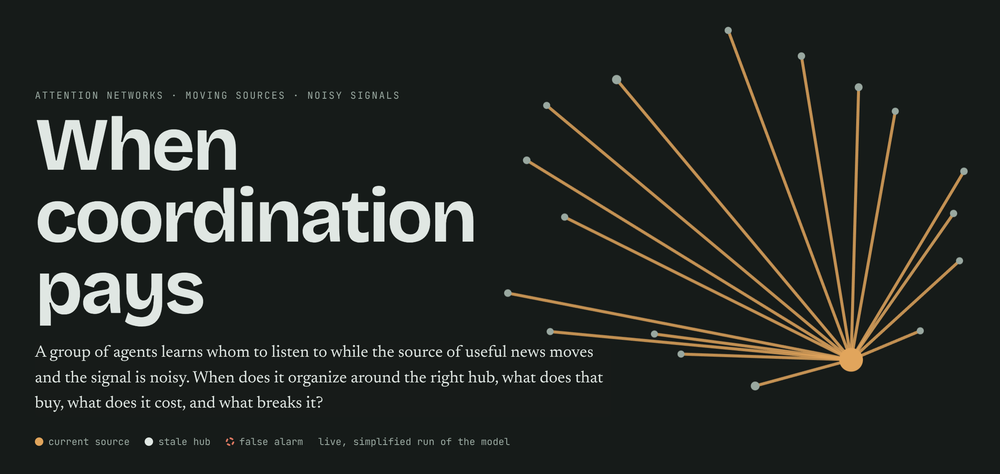

# When coordination pays



**Attention networks under a moving, noisy source: regimes, costs, mechanisms and implications.**

Groups have to decide whom to listen to. A team follows whoever has the freshest information about a client, a
community of experts defers to whoever has been right lately, a flock follows the animals that seem to know where the
food is. The source of useful information moves, and the signals about where it is are noisy. A group that commits to a
hub gains when the hub is right and pays when it is not; a group that never commits gains little but risks little. This
project asks when such coordination pays, what it buys, what it costs, and what breaks it.

## The model

N agents each split one unit of attention among the others. Every round a piece of news appears at one agent, the
source; with probability ν it appears at a random agent instead (a false alarm). Each agent then strengthens the links
that would have brought it the news soonest, counting paths through the network. Three knobs set how it learns:

- **self-reinforcement κ**: strong links earn more;
- **commitment T**: how hard an agent bets on its best link;
- **memory ε**: how fast old attention is replaced.

The source stays put for τ_E rounds on average, then moves.

## What we find

- **Coordination works in a window of commitment.** Below T = κ the group locks onto whoever led at the start, decided
  by a separatrix in the starting attention. Above T½ = κ + (1 − κ) ln ρ / ln(N − 2) attention spreads out. In between,
  a single hub forms on the current source and follows it when it moves.
- **Coordination has increasing returns to size.** A hub costs about twice as much as no structure (broadcast
  dissipation) at every group size, while its benefit (log-score gain) grows like ln(N − 1).
- **Noise is paid in precision, not structure.** False alarms do not raise the cost of a hub, but they shrink the usable
  window by a similar fraction at every size.
- **Tracking is more robust than mean-field theory predicts.** Near the lock-in edge, unequal rivals (a concavity
  effect) and relays through the hub keep the group on the source; switching each effect off in turn shows both matter.
- **Position beats direct evidence.** Rewarding a link for where it sits in the network outperforms rewarding direct
  evidence under noise, and comes within 1–3% of an ideal Bayesian observer up to 50% false alarms. Beyond that, the
  group's short memory is the limit.

## Where it comes from

The model joins three lines of work, none of which the write-up assumes you know:

- the **source-to-structure model** (Bromberg 2020): how the place where information appears shapes who listens to
  whom, measured with random-walk effective distance (Brockmann & Helbing 2013) and hierarchy coordinates
  (Corominas-Murtra et al. 2013);
- **optimal learning in noisy niches** (Lee, Flack & Krakauer 2024): how much memory a learner should keep when its
  environment switches;
- **adaptive transport networks** (Corson 2010; Katifori et al. 2010; Ronellenfitsch & Katifori 2016): networks that
  grow the links carrying flow under a budget, and form trees or loops depending on how the load fluctuates.

Every claim is tagged by provenance (stated in a source, behaviour of the reference code, derived, proposed, or a result
of this project), and errors found in the original thesis code are written up with a test each in
[docs/errata.md](docs/errata.md).

## Read it

- **The site** (`site/`): a chaptered, interactive version with live runs of the model, glossary hover cards and the
  appendices.
- **The paper** (`paper/`): the same results as a LaTeX article, with figures printed from the site. The site serves it
  as `/paper.pdf`.
- **The code and tests**: the site also offers `py/` as a zip (`/downloads/when-coordination-pays-python.zip`,
  archived from the deployed commit), with instructions for running the tests.
- **The notes** (`docs/`): [results](docs/results.md), [validation](docs/validation.md) and
  [errata](docs/errata.md).

By Claude (Opus 5.5) and Max Bromberg.

## Reproducing

```sh
make envs          # conda envs: nichenet (main) and nvd-legacy (runs the thesis code as an oracle)
make test          # nichenet tests, incl. golden traces recorded from the thesis code
make test-legacy   # checks of the thesis code's own behaviour
make site serve    # build and serve the private research site on localhost:8000
make release       # public site + figures exported from it + tables + paper, bundled -> site/out
make serve-public  # serve the public build on localhost:8001
```

- `py/` (`nichenet`): every model, bridge, metric and experiment. `ss/model.py` is the numpy reference for the
  source-to-structure model (faithful and clean modes), `ss/jax_kernel.py` the batched GPU path for sweeps, and
  `metrics/` the efficiency coordinates.
- [hierarchy-coordinates](https://github.com/Maqz-Bromberg/hierarchy-coordinates): the hierarchy coordinates of Corominas-Murtra et al. (2013) for weighted graphs,
  a separate package with its own tests. nichenet's `experiments` extra installs version 0.1.0, the last with the
  thesis variant that the errata and validation use.
- `site/`: the public Next.js site, a static export for GitHub Pages (`BASE_PATH` sets the repository path at build
  time). Hover cards, the figure lightbox and the scroll bar are adapted from remystifying-science (provenance lines at
  the top of each file).
- `web/`: the private research site, with a Pyodide lab that runs the model in the browser.
- `paper/`: LuaLaTeX sources. Figures come from `site/scripts/export-figures.mjs`, tables from `data/site/` via
  `paper/tables.py`; neither is in git.
- `tools/legacy_oracle/`: the environment and recorder for the 2020 thesis code. `reference/` (not in git) holds the
  clones; see [reference/README.md](reference/README.md).
- `papers/hosted/`: the openly licensed papers the site serves. Other papers stay out of git.
- `.github/workflows/pages.yml` builds the site, figures and paper and deploys them to GitHub Pages.
